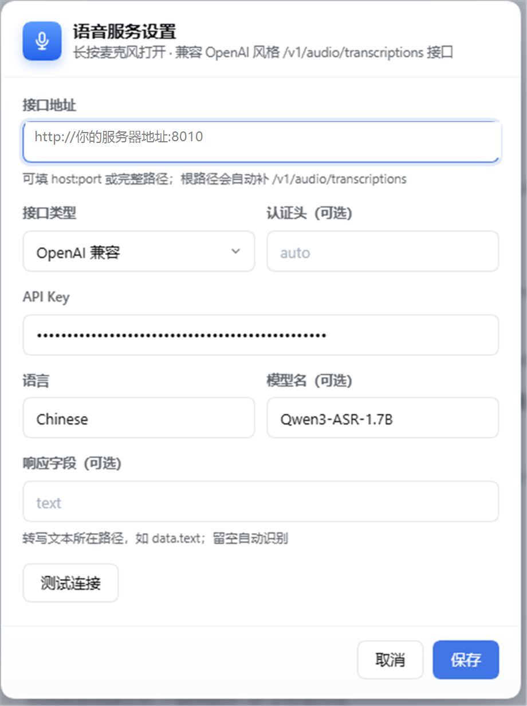

# DSH 语音输入插件

给 DeepSeek Harness 的输入框加一个麦克风按钮：**点一下开始录音，再点一下结束，文字自动插入光标处**。

插件只是"客户端"——录音在你的浏览器里完成，音频通过 HTTP 发给**你自己的语音识别服务**。不含任何内置服务地址或密钥，接哪个后端完全由你决定。


---

## 特性

- 🎙 **一键录音**：点击开始 / 结束，录音中按钮展开成声浪动画
- 🚀 **任意后端**：任何 OpenAI 风格的 `/v1/audio/transcriptions` 接口都能接（自建、OpenAI、Azure、硅基流动…）
- 🧹 **静音过滤**：没说话时服务返回的「嗯。」「Silence.」不会插进输入框
- ⏱ **自动停止**：最长 60 秒，短于 0.4 秒的误触直接丢弃
- 🔒 **隐私**：录音只在内存里，不落盘、不留历史
- 🌏 **中英双语**界面

---

## 安装

### 前置条件

- DeepSeek Harness（桌面版或 Web 版均可）
- 一个能从浏览器访问、且允许跨域的语音识别接口

### 步骤

**① 获取插件**

任选一种：

```bash
# 方式 A：克隆仓库
git clone https://github.com/nncscn/dsh-asr-voice.git
```

或直接下载发布页的压缩包：

**https://github.com/nncscn/dsh-asr-voice/releases**

**② 安装到 Harness**

在 Harness 的对话里让 AI 执行，或用插件管理界面：

```
plugin_manager  install_bundle  target: "你解压出来的 dsh-asr-voice 目录"
```

安装成功后，**输入框右侧、发送按钮左边**就会出现麦克风图标（见上图）。

---

## 首次配置

插件默认**不连接任何服务器**，第一次使用需要配置。

### 打开设置面板

**长按麦克风按钮约 0.5 秒**（或聚焦按钮后按 `Shift + Enter`），会弹出设置面板：



### 填写各项

| 字段 | 填什么 | 示例 |
|---|---|---|
| **接口地址** | 你的 ASR 服务地址 | `http://192.168.1.10:8010` |
| **接口类型** | 一般选 `OpenAI 兼容` | 见下方说明 |
| **认证头** | 一般留空（自动） | `auto` |
| **API Key** | 服务需要鉴权时填 | `sk-xxxx` |
| **语言** | 识别语言 | `Chinese` 或 `zh`，自动识别填 `auto` |
| **模型名** | 服务端要求的模型标识 | `whisper-1`、`Qwen3-ASR-1.7B` |
| **响应字段** | 一般留空（自动识别） | `text` / `data.text` |

### 点「测试连接」验证

会发送一段 0.5 秒静音去探活，按钮旁边显示结果：

- ✅ **连接成功** — 说明地址、密钥、协议都对
- ❌ **鉴权失败 (401)** — API Key 不对
- ❌ **请求失败 (404)** — 地址路径错
- ❌ **连接超时** — 服务没启动或网络不通

确认无误后点 **保存**，配置会记住，下次不用再填。

---

## 支持的接口类型

| 类型 | 适用服务 | 请求方式 |
|---|---|---|
| **OpenAI 兼容** | OpenAI、硅基流动、各类自建服务 | `multipart/form-data` + `Authorization: Bearer` |
| **Azure OpenAI** | Azure 上的 Whisper 部署 | `multipart/form-data` + `api-key` 头 |
| **JSON + Base64** | 只收 JSON 的自建服务 | JSON 体 `{ audio, language, model }` |

### 地址填写规则

| 你填 | 实际请求 |
|---|---|
| `192.168.1.10:8010` | `http://192.168.1.10:8010/v1/audio/transcriptions` |
| `https://api.xxx.com/v1` | `https://api.xxx.com/v1/audio/transcriptions` |
| `https://api.xxx.com/custom/path` | 原样使用 |
| Azure 的完整部署地址 | 原样使用（含 `?api-version=`） |

---

## 常见后端配置示例

### 1. OpenAI 官方

| 字段 | 值 |
|---|---|
| 接口地址 | `https://api.openai.com/v1/audio/transcriptions` |
| 接口类型 | OpenAI 兼容 |
| API Key | `sk-...` |
| 模型名 | `whisper-1` 或 `gpt-4o-transcribe` |
| 语言 | `zh` |

### 2. 自建 transcribe.cpp / whisper.cpp

| 字段 | 值 |
|---|---|
| 接口地址 | `http://192.168.1.10:8010` |
| 接口类型 | OpenAI 兼容 |
| API Key | 服务端设置的 token |
| 语言 | `Chinese` |

### 3. Azure OpenAI

| 字段 | 值 |
|---|---|
| 接口地址 | `https://你的资源.openai.azure.com/openai/deployments/whisper/audio/transcriptions?api-version=2024-06-01` |
| 接口类型 | **Azure OpenAI** |
| API Key | Azure 的 key |
| 模型名 | 可留空 |

---

## 使用

1. 点击麦克风 → 按钮展开成声浪条（下图），开始录音
2. 再点一下（或点条上的停止键）→ 停止并上传
3. 按钮转圈 → 转写完成后文字自动插入输入框


> 说话时波形随音量起伏；停止后蓝条向右收回，露出下面的工具栏。

---

## 常见问题

**Q：点了没反应？**

先看按钮是否变红——变红说明出错，鼠标悬停看原因。最常见是没配地址（长按设置）。

**Q：识别出来是「嗯。」或空白？**

插件会过滤纯语气词和静音标记，不会插入。

**Q：提示「无法连接」？**

① 服务是否启动；② 地址端口是否正确；③ 浏览器能否访问（跨域 CORS 是否允许）。

**Q：提示「鉴权失败」？**

API Key 不对，或该服务用的是自定义头（在「认证头」里填，如 `x-api-key`）。

**Q：能识别多长的音频？**

默认上限 60 秒，超过会自动停止并转写已录部分。

**Q：录音会上传到哪里？**

只发到**你自己配置的那个地址**，插件本身不经过任何第三方服务器。

---

## 隐私说明

- 音频只在内存中，**不写入磁盘**
- 插件不保存任何转写历史
- 配置（地址、Key）存在浏览器 `localStorage`
- 建议使用可撤销的专用 Key

---

## 许可证

MIT
